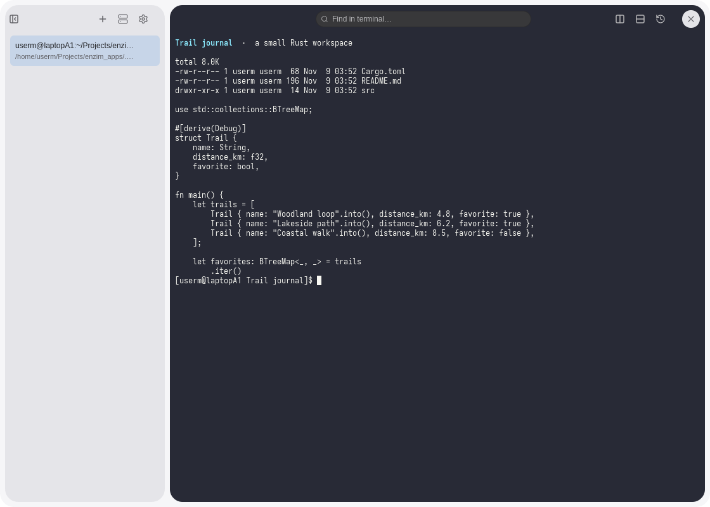
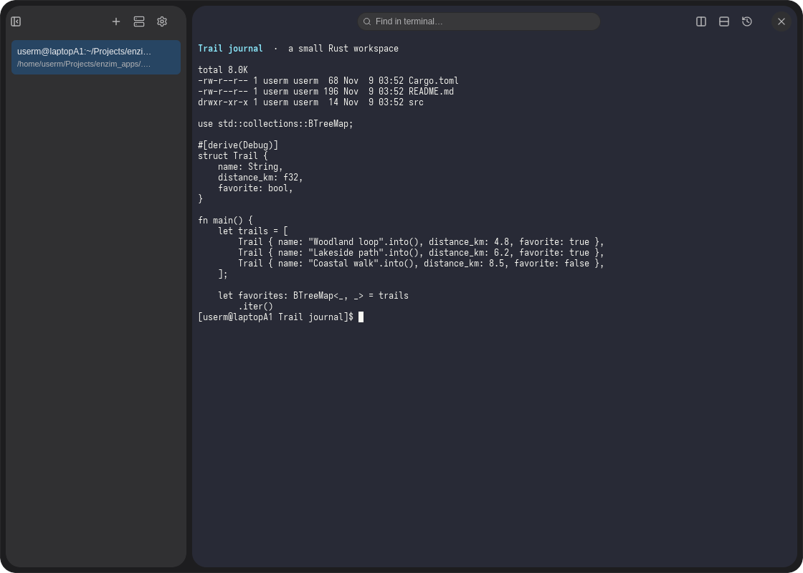
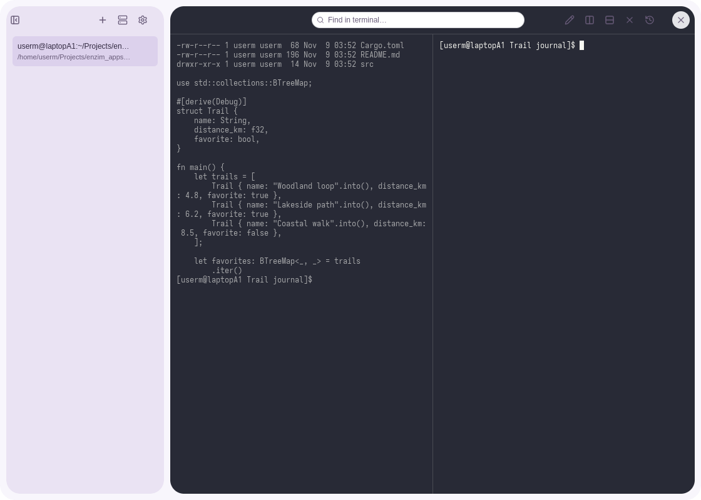
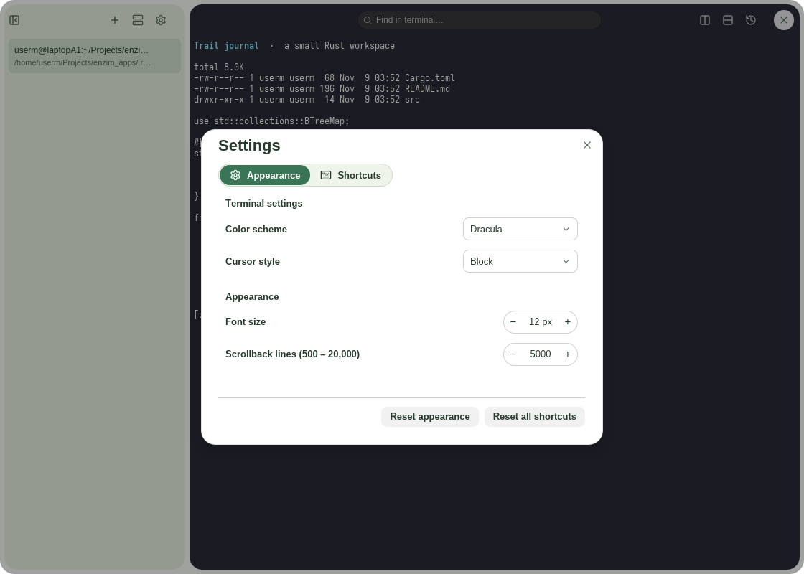
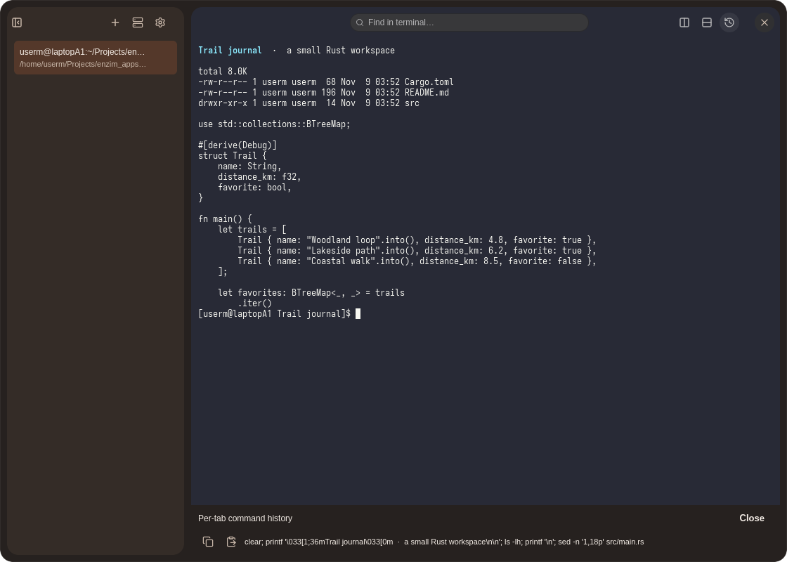
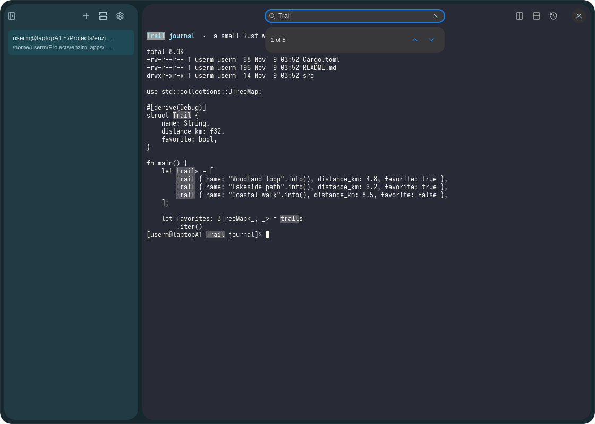
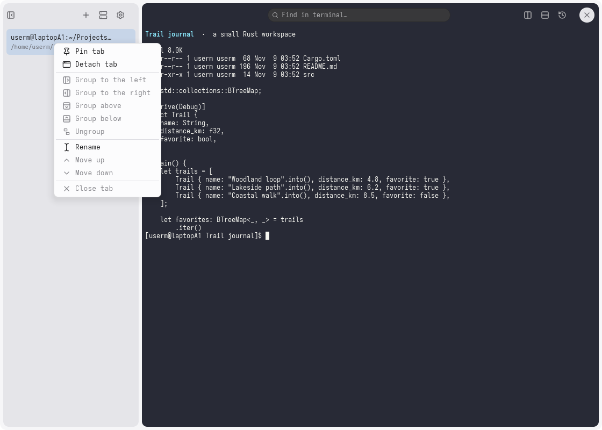
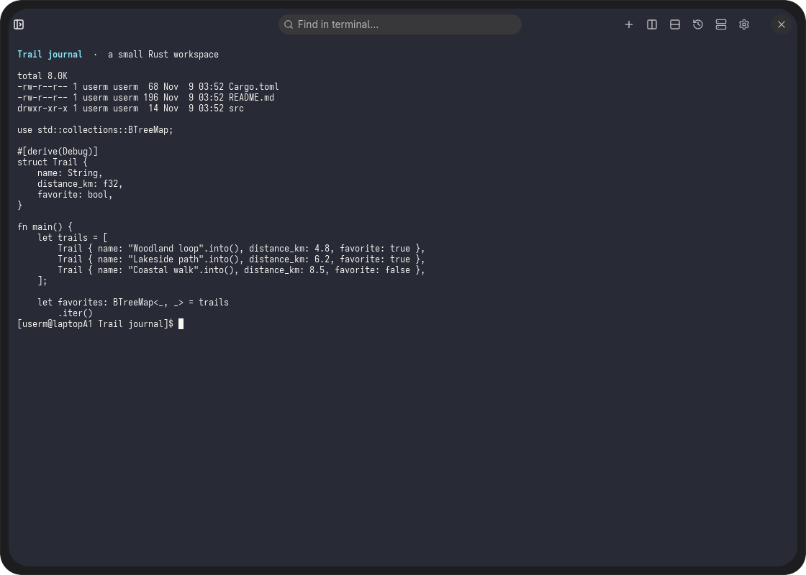

# Terminal

Run local shells and SSH sessions in a native terminal. Built with [enzUI](https://github.com/enz1m/enzui).

<table>
  <tr>
    <td align="center"><a href="docs/screenshots/basic-light.png"></a><br><sub>Local shell · light</sub></td>
    <td align="center"><a href="docs/screenshots/basic-dark.png"></a><br><sub>Local shell · dark</sub></td>
    <td align="center"><a href="docs/screenshots/lavender.png"></a><br><sub>Split panes</sub></td>
    <td align="center"><a href="docs/screenshots/sage.png"></a><br><sub>Preferences</sub></td>
  </tr>
  <tr>
    <td align="center"><a href="docs/screenshots/ember.png"></a><br><sub>Command history</sub></td>
    <td align="center"><a href="docs/screenshots/lagoon.png"></a><br><sub>Find in terminal</sub></td>
    <td align="center"><a href="docs/screenshots/precision.png"></a><br><sub>Session actions</sub></td>
    <td align="center"><a href="docs/screenshots/comfort.png"></a><br><sub>Sidebar hidden</sub></td>
  </tr>
</table>

Click a screenshot to enlarge. Images use isolated example data and shared enzUI themes.

## Features

- Tabs, pinned sessions and restored workspace metadata.
- Native PTYs, scrollback, selection, clipboard and links.
- SSH profiles with strict host trust and private credentials.

## Build and run

Use Rust **1.99.1** (minimum **1.95**), a C/C++ toolchain and pkg-config.
Linux UI builds need Wayland/XKB, GLib/GIO, fontconfig and Vulkan/EGL development support.
Local sessions need a shell and PTY support; SSH sessions use OpenSSH.

```sh
git clone https://github.com/enz1m/terminal.git
cd terminal
cargo build --locked
cargo run --locked
```

Dependencies pin public [enzUI Alpha 0.1](https://github.com/enz1m/enzui/releases/tag/v0.1.0-alpha.1)
and its matching public foundation forks. No sibling framework checkout is needed.
Wayland is enabled by default; use `--features x11` when X11 support is needed.
Use `cargo build --release --locked` for an optimized binary.

## Files and desktop integration

Use `terminal-emulator --working-directory /absolute/path` to open a project directory. This accepts a directory as data, not a shell command. Terminal does not register as a document editor.

## Requirements and limits

SSH requires OpenSSH and explicit trust for new hosts. A restored session starts a new shell; it cannot restore an old process. Shell startup files and host utilities remain under user control.

Shared enzUI theme settings apply live. Translations are under `assets/locales`;
locale coverage varies.

The terminal engine and parser use pinned public
[Alacritty](https://github.com/enz1m/enzim-alacritty) and
[VTE](https://github.com/enz1m/enzim-vte) forks. Their source, upstream history,
licenses and patch notes live in those repositories.

## Development

```sh
cargo fmt --all -- --check
ICED_TEST_BACKEND=software cargo test --locked --all-targets -- --test-threads=1
cargo clippy --locked --all-targets -- -D warnings
```

Keep tests for durable workflows, data integrity, resource ownership and security
boundaries. See [contributing](CONTRIBUTING.md).

Licensed under [MIT](LICENSE); retained dependency notices and licenses apply to
third-party code and assets.
